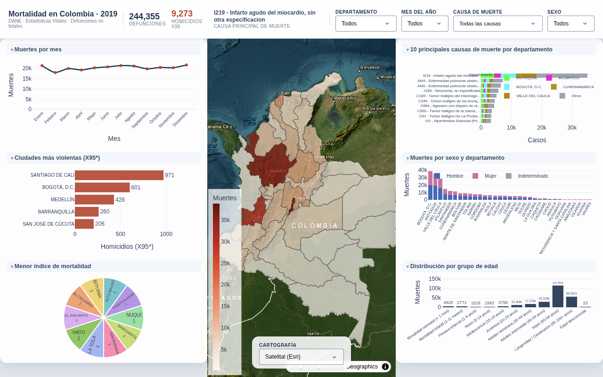
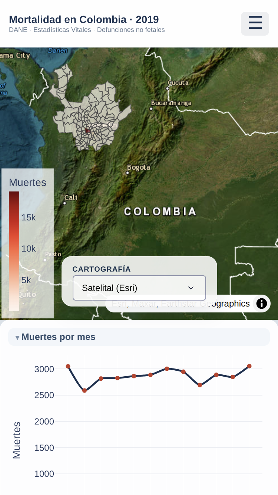
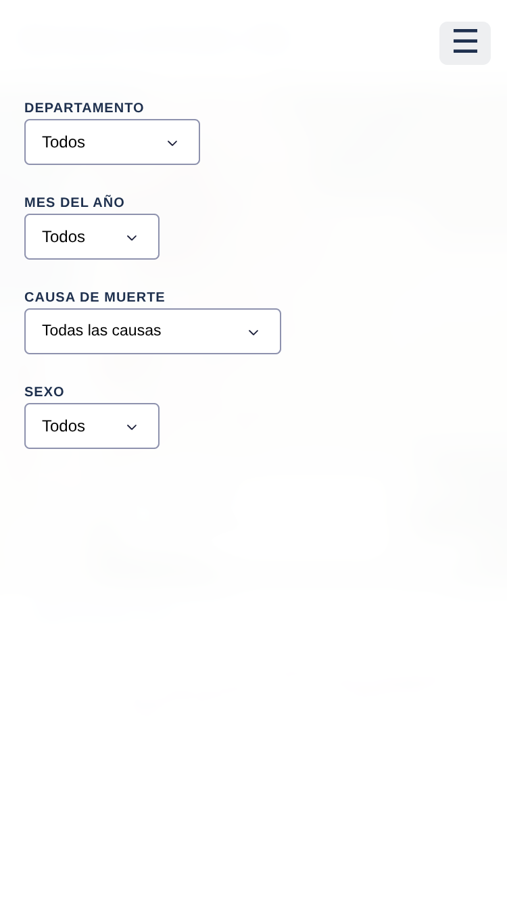

# Mortalidad en Colombia 2019 — Dashboard con Dash y Plotly

Aplicación web dinámica que analiza las defunciones no fetales registradas en
Colombia durante 2019 (244.355 registros), construida con Dash y Plotly.

**Aplicación en línea:** <http://34.203.223.230:8050/>

## Introducción del proyecto

Este proyecto presenta un tablero interactivo de mortalidad en Colombia a
partir de las **Estadísticas Vitales del DANE** (defunciones no fetales, año
2019). El conjunto de datos procesado contiene **244.355 registros**, uno por
defunción, y un catálogo CIE-10 con **14.621 códigos** únicos para describir la
causa básica de muerte.

El tablero se organiza alrededor de un mapa coroplético a pantalla completa y
seis gráficas laterales. Cuatro filtros —**departamento**, **mes del año**,
**causa de muerte (CIE-10)** y **sexo**— actualizan de forma simultánea todas
las visualizaciones y los indicadores del encabezado (total de defunciones,
homicidios por arma de fuego X95* y causa principal de muerte).

El mapa muestra la distribución por departamento a nivel nacional y, al elegir
un departamento en el filtro, cambia automáticamente a la vista **municipal**
de ese departamento. La cartografía predeterminada es **satelital (Esri)** y
puede cambiarse —OpenStreetMap, Carto Claro, Carto Oscuro o Carto Voyager—
desde un selector flotante ubicado **dentro del propio mapa**, sin salir de la
vista.



## Objetivo

Construir y publicar una aplicación web dinámica, reproducible y documentada
que permita explorar la mortalidad no fetal en Colombia durante 2019,
cumpliendo estos elementos solicitados por la actividad:

1. Mapa coroplético de muertes por departamento (y por municipio al filtrar).
2. Gráfico de líneas con el total de muertes por mes.
3. Gráfico de barras con las cinco ciudades más violentas (homicidios CIE-10
   X95*).
4. Gráfico circular con las diez ciudades de menor mortalidad.
5. Gráfica de las diez principales causas de muerte, desglosada por
   departamento.
6. Barras apiladas de muertes por sexo en cada departamento.
7. Histograma de la distribución de muertes por grupo de edad.

Además, el proyecto documenta el despliegue real de la aplicación en AWS EC2
con Gunicorn y systemd, y deja instrucciones para ejecutarla localmente o
publicarla en una plataforma PaaS como Render.

## Estructura del proyecto

```
├── app.py                              # Aplicación Dash (punto de entrada; expone app:server)
├── prep_data.py                        # Preprocesamiento de los anexos Excel a Parquet
├── requirements.txt                    # Dependencias de ejecución y despliegue
├── Procfile                            # Comando de arranque para plataformas PaaS
├── Anexo1.NoFetal2019_CE_15-03-23.xlsx # Defunciones no fetales 2019 (DANE, original)
├── Anexo2.CodigosDeMuerte_CE_15-03-23.xlsx # Catálogo CIE-10 (DANE, original)
├── Divipola_CE_.xlsx                   # Codificación DIVIPOLA (DANE, original)
├── data/
│   ├── mortalidad_2019.parquet         # Datos procesados (incluido)
│   ├── cie10.parquet                   # Catálogo CIE-10 procesado (incluido)
│   ├── colombia_departamentos.geojson  # Geometrías departamentales (incluido)
│   └── colombia_municipios.geojson     # Geometrías municipales (incluido)
├── docs/
│   └── images/                         # Capturas del dashboard y de la vista móvil
└── tests/
    └── test_responsive.py              # Pruebas del layout responsive
```

Los **datos procesados y las geometrías están incluidos en el repositorio**,
por lo que la aplicación se ejecuta de inmediato tras instalar dependencias.
Los Excel originales solo se necesitan para regenerar los Parquet con
`prep_data.py`.

## Requisitos

- Python 3.12 o superior (verificado con Python 3.12.3 en local y Python
  3.14.4 en el servidor de despliegue).
- Dependencias de `requirements.txt`: `dash==4.4.1`, `plotly==7.1.0`,
  `pandas==2.3.3`, `pyarrow>=14.0.0`, `openpyxl>=3.1.0`, `gunicorn>=21.2.0`.
- Navegador web moderno. El mapa satelital y las cartografías alternativas
  descargan teselas públicas (Esri, OpenStreetMap, Carto) al visualizarse, por
  lo que requieren conexión a internet.

## Despliegue

### Despliegue real: AWS EC2 con Gunicorn y systemd

La aplicación pública <http://34.203.223.230:8050/> se ejecuta en una
instancia de **AWS EC2**, servida por **Gunicorn** y administrada como un
servicio de **systemd**. Esta es la configuración observada en el servidor
(verificada el 28-10-2026 con consultas de solo lectura):

- Servicio systemd `dashapp`: activo, en ejecución y habilitado al arranque
  (unidad en `/etc/systemd/system/dashapp.service`).
- Usuario del servicio: `ubuntu`; directorio de trabajo
  `/home/ubuntu/dash_app`.
- Comando de arranque del servicio:

  ```ini
  ExecStart=/home/ubuntu/dash_app/.venv/bin/gunicorn app:server --bind 0.0.0.0:8050 --workers 1 --timeout 120
  Restart=always
  RestartSec=5
  ```

- Versiones instaladas en el servidor: Python 3.14.4 (entorno virtual),
  dash 4.4.1, plotly 7.1.0, pandas 2.3.3, pyarrow 26.0.0, openpyxl 3.1.5 y
  gunicorn 26.2.0.
- En el servidor existen `app.py`, `requirements.txt`, ambos Parquet y ambos
  GeoJSON; la aplicación responde HTTP 200 con el título «Mortalidad en
  Colombia 2019».

En este esquema, GitHub aloja el código y los datos, y EC2 ejecuta la
aplicación: apagar el computador local no interrumpe el servicio, pero detener
la instancia EC2 sí deja la aplicación indisponible.

### Alternativa PaaS: Render

Como **alternativa** (la aplicación no está desplegada actualmente allí), el
repositorio incluye `requirements.txt` y `Procfile`, suficientes para
publicarla en Render:

1. Subir el proyecto a un repositorio en GitHub (incluyendo la carpeta
   `data/`, así no es necesario subir los `.xlsx`).
2. En [Render](https://render.com): **New → Web Service →** conectar el
   repositorio.
3. Configurar:
   - **Build Command:** `pip install -r requirements.txt`
   - **Start Command:** `gunicorn app:server --workers 1 --timeout 120`
4. Deploy. Render asigna la variable `PORT` automáticamente y la app queda
   accesible en una URL pública `https://<nombre>.onrender.com`.

En Railway, Google App Engine u otras plataformas similares, el mismo par de
archivos sirve como punto de partida; el servidor WSGI es siempre
`app:server`.

## Software

| Componente | Versión declarada (`requirements.txt`) | Versión verificada en EC2 |
|---|---|---|
| Python | 3.12+ (local: 3.12.3) | 3.14.4 (entorno virtual) |
| Dash | 4.4.1 | 4.4.1 |
| Plotly | 7.1.0 | 7.1.0 |
| pandas | 2.3.3 | 2.3.3 |
| pyarrow | ≥ 14.0.0 | 26.0.0 |
| openpyxl | ≥ 3.1.0 | 3.1.5 |
| Gunicorn | ≥ 21.2.0 | 26.2.0 |

Otras piezas: servidor WSGI Gunicorn, administración del proceso con systemd
en Ubuntu (AWS EC2), mapas con Plotly `choropleth_map` (MapLibre, sin token) y
teselas públicas de Esri/OpenStreetMap/Carto.

## Instalación

```bash
git clone https://github.com/TU_USUARIO/mortalidad-colombia-2019-dash.git
cd mortalidad-colombia-2019-dash
python -m venv .venv
source .venv/bin/activate        # Windows: .venv\Scripts\activate
pip install -r requirements.txt
python app.py                    # http://localhost:8050
```

> La URL de `git clone` anterior es una **plantilla**: reemplaza `TU_USUARIO`
> por el usuario u organización de GitHub donde se publique el repositorio.

Los datos procesados (`data/*.parquet`) y las geometrías (`data/*.geojson`)
vienen incluidos, así que no hace falta ningún paso adicional para ejecutar la
aplicación. Solo si se desea **regenerar** los Parquet desde los anexos
originales del DANE:

```bash
python prep_data.py              # lee los .xlsx y reescribe data/*.parquet
```

### Pruebas

```bash
python -m unittest discover -s tests -v
```

La suite `tests/test_responsive.py` contiene **7 pruebas**, todas en estado
OK, que verifican el comportamiento responsive del layout:

1. Existe el botón hamburguesa (`#boton-menu`).
2. El menú de filtros contiene los cuatro filtros (departamento, mes, causa y
   sexo).
3. El layout incluye las clases del contenedor responsive
   (`contenedor-dashboard`, columnas y envoltorio del mapa).
4. El CSS embebido incluye la media query móvil (`max-width: 900px`).
5. Hay un callback registrado que controla la clase de `#menu-filtros`.
6. `alternar_menu` abre y cierra el menú preservando la clase base.
7. El selector de cartografía queda por debajo del menú del encabezado (índice
   z menor que 2000).

## Visualizaciones con explicaciones de los resultados

Todas las cifras siguientes corresponden al estado nacional por defecto
(departamento: Todos, mes: Todos, causa: Todas, sexo: Todos), calculadas sobre
`data/mortalidad_2019.parquet` con las mismas agrupaciones que implementa
`app.py`.

**Nota metodológica general:** todas las visualizaciones del tablero trabajan
con **conteos absolutos de defunciones**, no con tasas ajustadas por
población. En particular, los gráficos de «ciudades más violentas» y de
«menor índice de mortalidad» comparan números de registros, por lo que
favorecen a municipios grandes (en el primer caso) y a municipios pequeños o
con registros incompletos (en el segundo). No deben interpretarse como tasas
de homicidio ni de mortalidad por habitante.

### 1. Mapa coroplético por departamento y municipio

El mapa colorea cada departamento según su total de defunciones (escala
continua de rojos) sobre la cartografía satelital de Esri. Al filtrar por un
departamento, la vista cambia a sus municipios y se encuadra automáticamente
en ese territorio. El selector flotante dentro del mapa permite cambiar la
cartografía de fondo (Satelital Esri, OpenStreetMap, Carto Claro, Carto
Oscuro, Carto Voyager).

Los cinco departamentos con más defunciones registradas en 2019 fueron:

| Departamento | Total | % nacional |
|---|---:|---:|
| Bogotá, D.C. | 38.760 | 15,86 % |
| Antioquia | 34.473 | 14,11 % |
| Valle del Cauca | 28.443 | 11,64 % |
| Atlántico | 14.804 | 6,06 % |
| Santander | 11.894 | 4,87 % |

Concentran en conjunto cerca del 52 % de las defunciones, un patrón
consistente con la distribución de la población del país (son conteos, no
tasas).

En pantallas de hasta 900 px el tablero adopta una disposición vertical: el
mapa (ahora con altura de 55 % de la ventana) aparece primero y las gráficas
se apilan debajo; los filtros se ocultan tras un botón hamburguesa.





### 2. Muertes por mes (línea)

La línea muestra el total anual mes a mes y resalta el mes seleccionado en el
filtro. **Diciembre** fue el mes con más defunciones (**21.678**) y
**febrero** el de menos (**17.974**). La serie es relativamente estable al
rededor de las 20.000 muertes mensuales, con un repunte hacia el cierre del
año.

### 3. Ciudades más violentas — homicidios por arma de fuego (CIE-10 X95*)

La barra horizontal toma los registros cuya causa básica comienza por `X95`
(agresiones con armas de fuego) y muestra los cinco municipios con más casos.
A nivel nacional se registraron **9.273** defunciones X95*; las cinco ciudades
principales fueron:

| Municipio | Homicidios X95* |
|---|---:|
| Santiago de Cali | 971 |
| Bogotá, D.C. | 601 |
| Medellín | 428 |
| Barranquilla | 260 |
| San José de Cúcuta | 206 |

Recuerde que son **conteos absolutos**: no son tasas por habitante, y la
agrupación se hace por nombre de municipio (como en `app.py`), no por código
DANE.

### 4. Menor índice de mortalidad (gráfico circular)

El gráfico circular muestra los diez municipios con menos defunciones
registradas (`groupby("MUNICIPIO").nsmallest(10)`). Con los filtros nacionales,
los diez municipios mostrados tienen **1 defunción cada uno**: Alto Baudó,
Bituima, El Calvario, El Encanto, Hato, La Tola, Mapiripana, Margarita, Nuquí
y Puerto Alegría.

Limitaciones importantes de esta visualización:

- Son conteos absolutos, **no tasas poblacionales**: un municipio con una sola
  defunción registrada no es necesariamente el de menor mortalidad real.
- Existe un **empate**: 13 municipios tienen exactamente 1 registro, pero el
  corte de diez deja fuera a Puerto Arica, San Fernando y Taraira.
- Los municipios **sin ningún registro no aparecen** como cero.
- La agrupación usa el **nombre** del municipio, no el código DANE; 66 nombres
  corresponden a más de un código en el conjunto, lo que puede fusionar
  municipios homónimos.

### 5. Diez principales causas de muerte (barras apiladas por departamento)

Esta gráfica toma las diez causas CIE-10 más frecuentes y divide cada barra en
segmentos por departamento. Según la lógica implementada en `app.py`
(`fig_principales_causas`), el desglose **no dibuja los 33 departamentos**:
primero selecciona los **cinco departamentos con más casos dentro del
conjunto de esas diez causas** (a nivel nacional resultan Antioquia,
Atlántico, Bogotá D.C., Cundinamarca y Valle del Cauca, ordenados
alfabéticamente en la leyenda) y **agrupa todos los demás departamentos en un
segmento único llamado `Otros`**. Cada departamento conserva un color fijo en
todo el dashboard.

Las diez causas principales a nivel nacional fueron:

| # | Código | Causa (CIE-10) | Total | Tres departamentos con más casos |
|---:|---|---|---:|---|
| 1 | I219 | Infarto agudo del miocardio, sin otra especificación | 35.088 | Bogotá, D.C.: 5.011; Valle del Cauca: 4.468; Antioquia: 4.391 |
| 2 | J449 | Enfermedad pulmonar obstructiva crónica, no especificada | 7.210 | Antioquia: 1.232; Bogotá, D.C.: 1.231; Valle del Cauca: 577 |
| 3 | J440 | Enfermedad pulmonar obstructiva crónica con infección aguda de las vías respiratorias inferiores | 6.445 | Bogotá, D.C.: 1.117; Valle del Cauca: 784; Antioquia: 698 |
| 4 | J189 | Neumonía, no especificada | 5.798 | Antioquia: 904; Bogotá, D.C.: 649; Valle del Cauca: 587 |
| 5 | C169 | Tumor maligno del estómago, parte no especificada | 5.125 | Bogotá, D.C.: 1.103; Antioquia: 717; Valle del Cauca: 605 |
| 6 | C349 | Tumor maligno de los bronquios o del pulmón, parte no especificada | 4.438 | Antioquia: 1.127; Bogotá, D.C.: 649; Valle del Cauca: 451 |
| 7 | X954 | Agresión con disparo de otras armas de fuego, y las no especificadas, calles y carreteras | 4.396 | Valle del Cauca: 906; Antioquia: 795; Cauca: 360 |
| 8 | C509 | Tumor maligno de la mama, parte no especificada | 3.619 | Bogotá, D.C.: 680; Antioquia: 507; Valle del Cauca: 472 |
| 9 | C61 | Tumor maligno de la próstata | 3.437 | Bogotá, D.C.: 591; Antioquia: 465; Valle del Cauca: 419 |
| 10 | I10 | Hipertensión esencial (primaria) | 3.317 | Antioquia: 699; Bolívar: 330; Atlántico: 271 |

El hallazgo central es el dominio del **infarto agudo de miocardio (I219)**,
que con 35.088 casos supera más de cuatro veces a la segunda causa y representa
por sí solo cerca del 14,4 % de todas las defunciones. Llama la atención la
presencia de la causa violenta **X954** en séptimo lugar, con 4.396 casos,
concentrados en Valle del Cauca y Antioquia.

### 6. Muertes por sexo y departamento (barras apiladas)

Las barras apiladas muestran el total por departamento separado en Hombre,
Mujer e Indeterminado (al filtrar un departamento, el eje pasa a sus quince
municipios con más registros). La distribución nacional de 2019 fue:

| Sexo | Total | % nacional |
|---|---:|---:|
| Hombre | 134.573 | 55,07 % |
| Mujer | 109.689 | 44,89 % |
| Indeterminado | 93 | 0,04 % |

Los hombres concentran cerca de diez puntos porcentuales más que las mujeres,
un exceso visible en prácticamente todos los departamentos.

### 7. Distribución por grupo de edad (histograma)

El histograma usa la clasificación de edad del DANE (`GRUPO_EDAD1`), en el
orden definido por la aplicación:

| Categoría | Total |
|---|---:|
| Mortalidad neonatal (< 1 mes) | 4.520 |
| Mortalidad infantil (1-11 meses) | 2.771 |
| Primera infancia (1-4 años) | 1.518 |
| Niñez (5-14 años) | 1.993 |
| Adolescencia (15-19 años) | 3.795 |
| Juventud (20-29 años) | 11.840 |
| Adultez temprana (30-44 años) | 17.276 |
| Adultez intermedia (45-59 años) | 29.105 |
| Vejez (60-84 años) | 115.453 |
| Longevidad / Centenarios (85-100+ años) | 56.061 |
| Edad desconocida | 23 |

La mortalidad se concentra con claridad en la **vejez** (115.453 defunciones,
el 47,2 % del total) y la **longevidad** (56.061; 22,9 %): entre ambas
categorías suman cerca del 70 % de los registros, el patrón típico de un país
con transición epidemiológica avanzada. Solo 23 registros tienen edad
desconocida.
